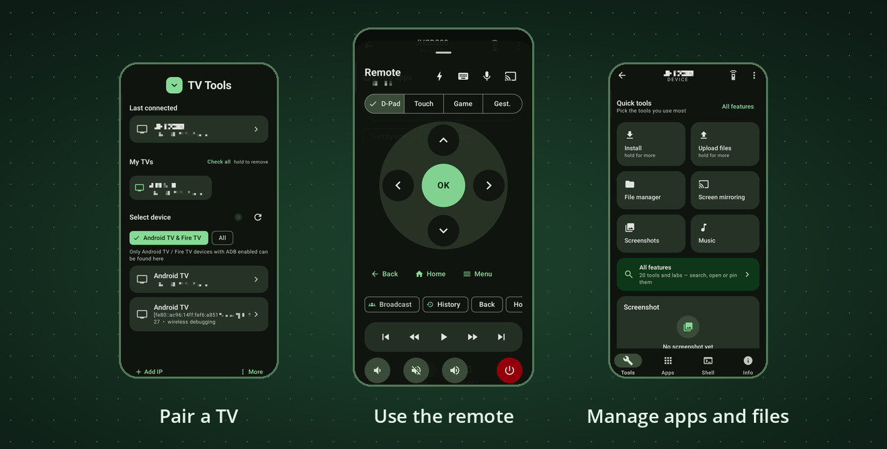

<h1>TV Tools</h1>

<strong>Use your Android phone as a remote for your TV.</strong>

Android TV · Google TV · Xiaomi TV · Fire TV

  <strong><a href="https://github.com/Avithegod2010/TV-Tools/releases/download/v1.8.1/TV-Tools-v1.8.1-release.apk">Download APK v1.8.1</a></strong> ·
  <a href="#pair-your-tv">Pair your TV</a> ·
  <a href="https://github.com/Avithegod2010/TV-Tools/releases/tag/v1.8.1">Release notes</a>

Android 8.0 or newer · Same Wi-Fi network as your TV · No root or account required

## What you can do

- **Control your TV.** Use a D-pad, touchpad or keyboard from your phone.
- **Manage apps and files.** Install APKs, back up TV apps and move files over Wi-Fi.
- **Mirror the screen.** View the TV on your phone and tap or swipe to control it.

## Pair your TV

1. Install the signed APK on your **Android phone**.
2. Connect your phone and TV to the same Wi-Fi network.
3. Enable developer options and debugging on the TV. On Android TV, Google TV and Xiaomi TV, use **Wireless debugging → Pair device with pairing code** when available. On Fire TV, enable **ADB debugging** and accept the permission prompt when connecting.

[Step-by-step instructions for each TV](GUIDE.md#enable-adb-on-your-tv)

## Explore the app

[See all 13 screenshots](GUIDE.md#screenshots) · [Full feature list](GUIDE.md#features)

## Privacy and security

TV Tools communicates with your TV over your local network. It keeps the ADB key on your phone and uses no analytics or cloud account. Enable debugging only on TVs you trust. [Security policy](SECURITY.md)

## Project links

[Build from source](GUIDE.md#build-from-source) · [Roadmap](GUIDE.md#roadmap) · [Contributing](CONTRIBUTING.md) · [Changelog](CHANGELOG.md) · [MIT license](LICENSE)
