<div align="center">

<h1>TV Tools</h1>

<p><strong>Turn your Android phone into a remote for your TV.</strong></p>

<p><strong><a href="https://github.com/Avithegod2010/TV-Tools/releases/download/v1.8.1/TV-Tools-v1.8.1-release.apk">⬇️ Download APK v1.8.1</a></strong> · <a href="#pair-your-tv">📡 Pair your TV</a> · <a href="#screenshots">🎮 See the remote</a> · <a href="https://github.com/Avithegod2010/TV-Tools/releases/tag/v1.8.1">Release notes</a></p>

<picture>
  <source media="(prefers-reduced-motion: reduce)" srcset="readme-hero.png" />
  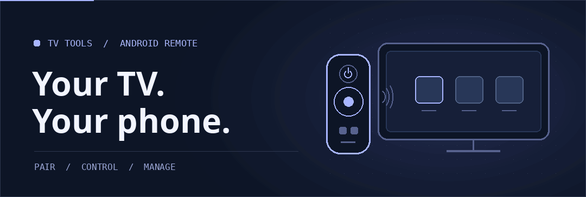
</picture>

<p><sub>Android 8.0+ · Android TV, Google TV, Xiaomi TV and Fire TV · Same Wi-Fi network · No root or account</sub></p>

</div>

<a name="-screenshots"></a>
<a name="explore-the-app"></a>

<a name="screenshots"></a>

## 🎮 Screenshots

<p align="center">
  <a href="docs/screenshots/03-remote.png">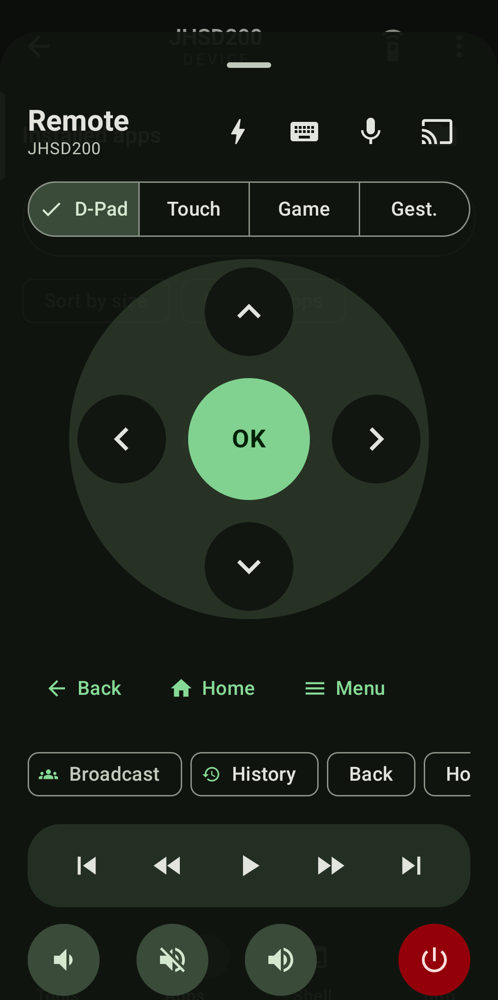</a>
  <a href="docs/screenshots/01-home.png">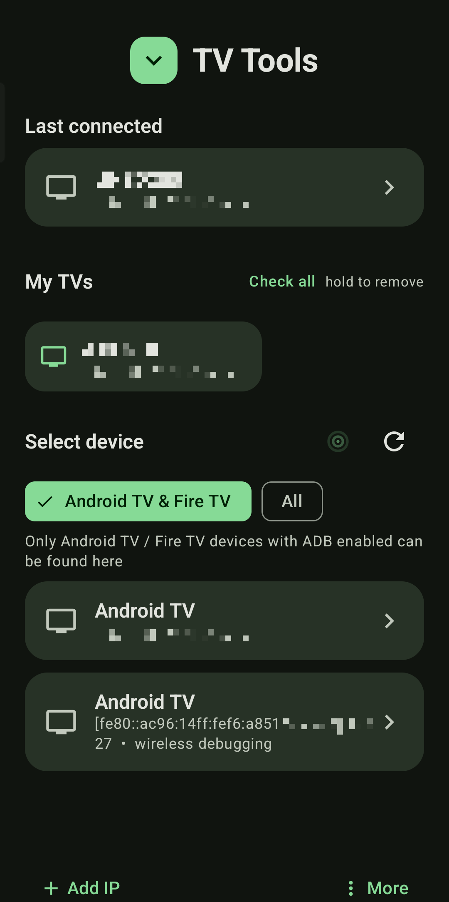</a>
  <a href="docs/screenshots/02-tools.png">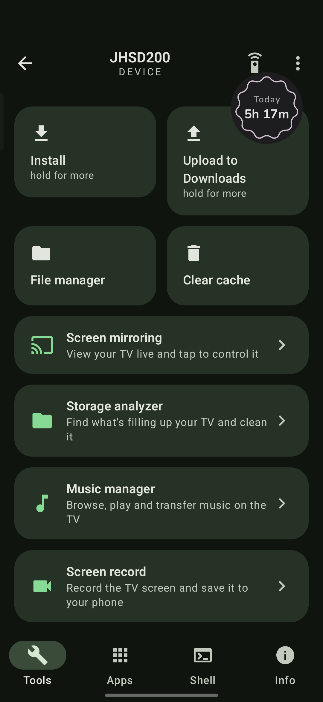</a>
</p>

<p align="center"><sub>Remote controls · Discover and pair · Apps and files</sub></p>

<details>
<summary>See 10 more screenshots</summary>

<p align="center">
  <a href="docs/screenshots/04-info.png">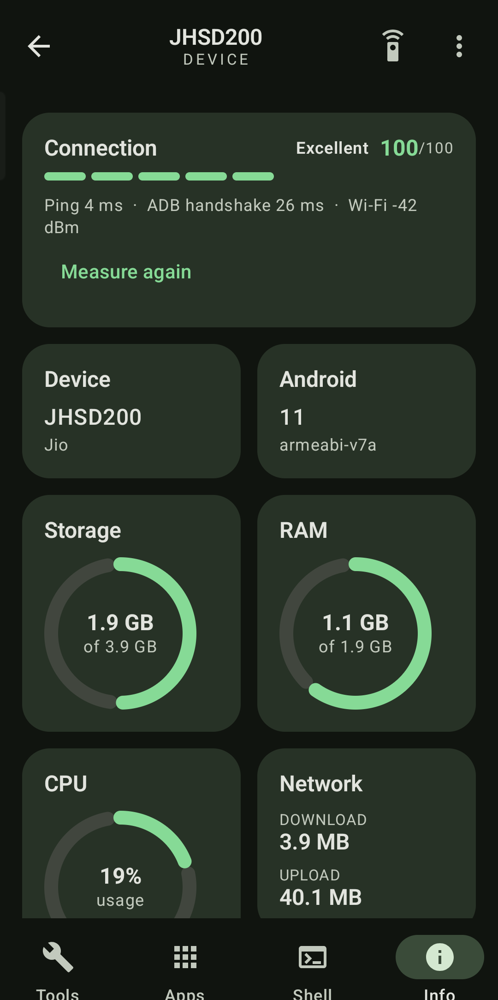</a>
  <a href="docs/screenshots/05-files.png">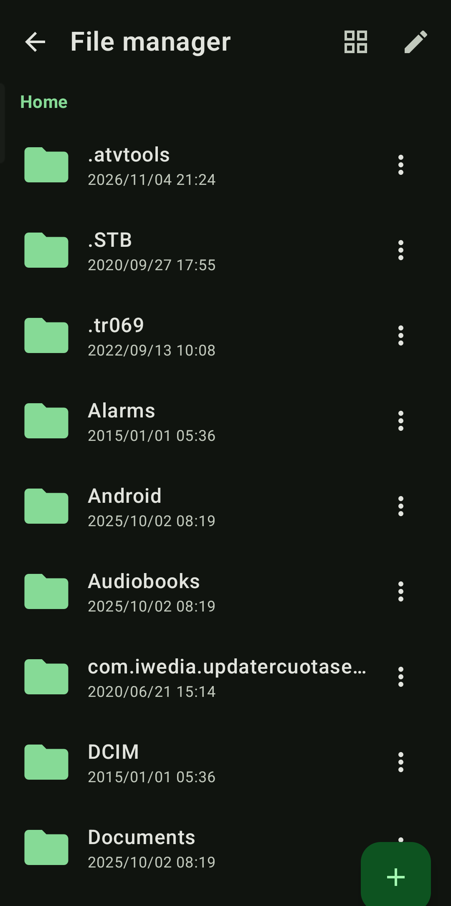</a>
  <a href="docs/screenshots/06-labs.png">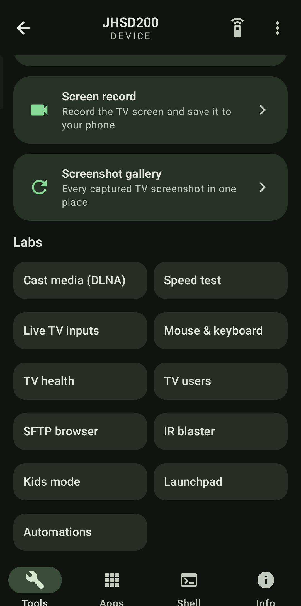</a>
</p>

<p align="center">
  <a href="docs/screenshots/07-shell.png">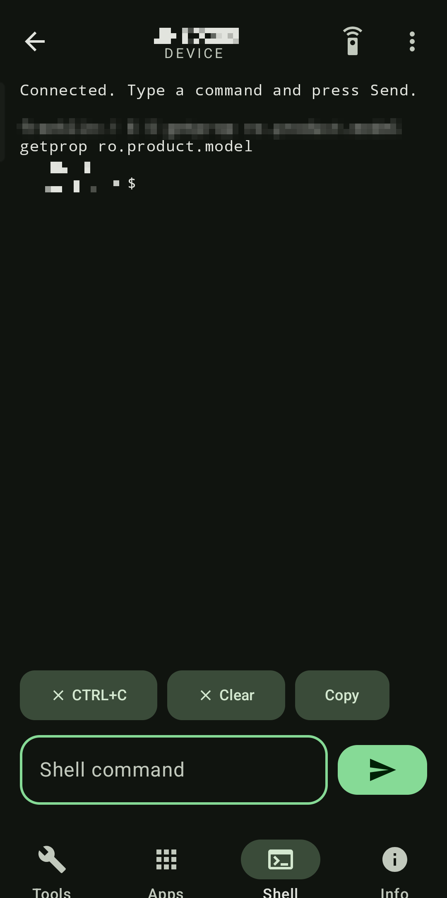</a>
  <a href="docs/screenshots/08-rooms.png">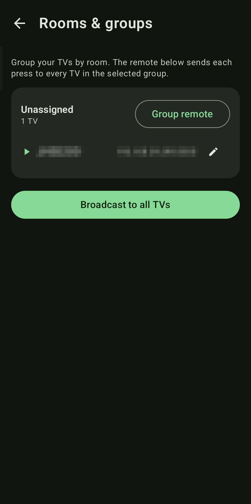</a>
  <a href="docs/screenshots/09-qr.png">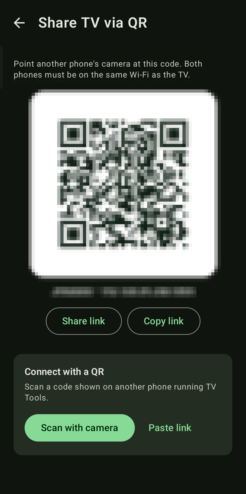</a>
</p>

<p align="center">
  <a href="docs/screenshots/10-mdns.png">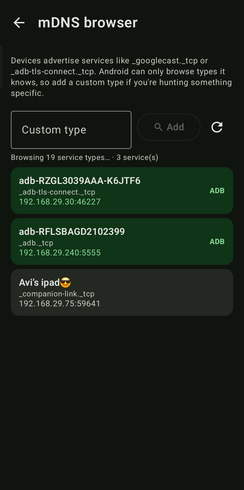</a>
  <a href="docs/screenshots/11-settings.png">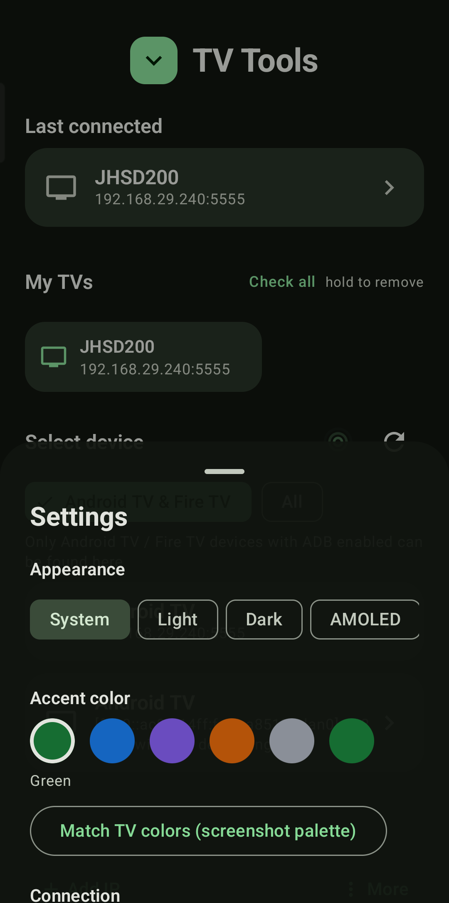</a>
  <a href="docs/screenshots/12-all-features.png">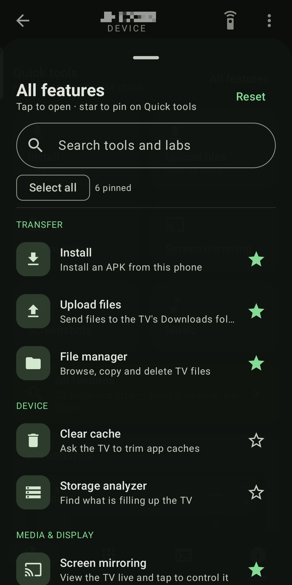</a>
</p>

<p align="center">
  <a href="docs/screenshots/13-music.png">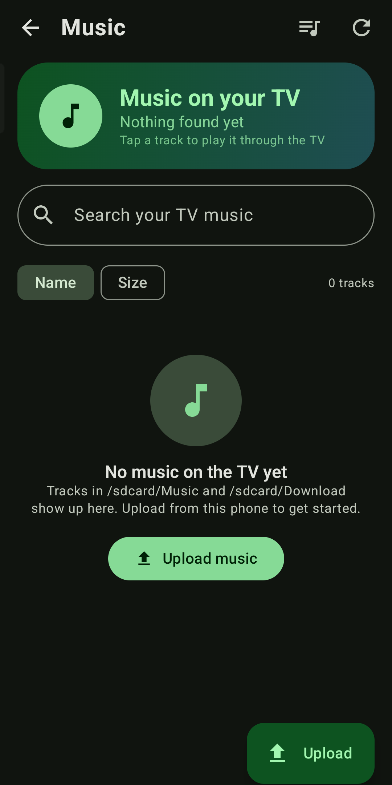</a>
</p>

</details>

<a name="-features"></a>

<a name="what-you-can-do"></a>

## 📺 What you can do

| 🎮 Remote controls | 📦 Apps and files | 📺 Screen and rooms |
| --- | --- | --- |
| Use a D-pad, touchpad or keyboard from your phone. | Install APKs, back up TV apps and move files over Wi-Fi. | Mirror the screen with tap and swipe controls, or group TVs by room. Send remote commands to a group and schedule Wake-on-LAN. |

<a name="-install"></a>
<a name="-enable-adb-on-your-tv"></a>

<a name="pair-your-tv"></a>

## 📡 Pair your TV

> [!TIP]
> Install the signed APK on your **Android phone** and connect your phone and TV to the same Wi-Fi network.

### Android TV, Google TV and Xiaomi TV

1. On your TV, open **Settings → Device Preferences → About** and tap **Build** seven times.
2. Open **Developer options** and turn on **Wireless debugging**, if available.
3. Choose **Pair device with pairing code** on the TV. Select your TV in TV Tools and enter the six-digit code.

### Amazon Fire TV

1. On your Fire TV, open **Settings → My Fire TV → About** and tap the device name seven times.
2. In **Developer Options**, turn on **ADB debugging**.
3. Connect in TV Tools using port `5555` and accept the debugging prompt on the TV.

<a name="-privacy--security"></a>

<a name="privacy-and-security"></a>

## 🔒 Privacy and security

TV Tools talks to your TV over your local network. The ADB key stays on your phone, and the app uses no analytics or cloud account. Enable debugging only on TVs you trust. [Security policy](SECURITY.md)

<a name="-build-from-source"></a>

<a name="build-from-source"></a>

## 🛠️ Build from source

<details>
<summary>Debug build instructions</summary>

Install JDK 17 and Android SDK 35. From the repository root, run:

```bash
./gradlew assembleDebug
```

The APK is written to `app/build/outputs/apk/debug/app-debug.apk`. [Release signing](GUIDE.md#build-from-source)

</details>

<a name="-roadmap"></a>
<a name="-contributing"></a>
<a name="-license"></a>

## Project links

[Full feature list and roadmap](GUIDE.md#features) · [Contributing](CONTRIBUTING.md) · [Changelog](CHANGELOG.md) · [MIT license](LICENSE)
