<div align="center">
  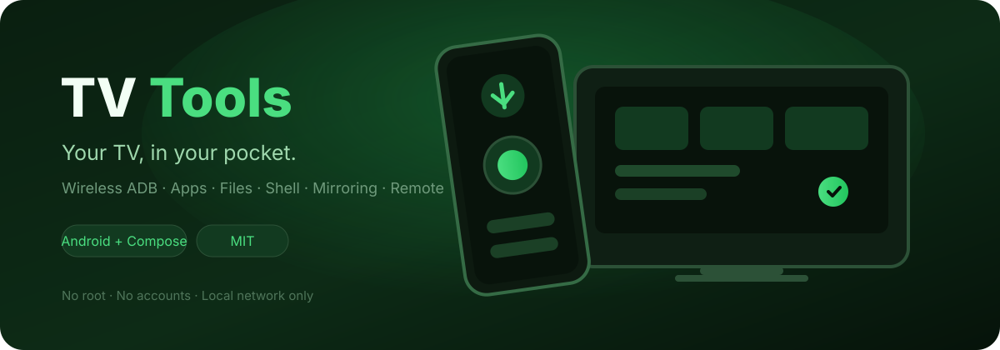

  <h1>TV Tools</h1>

  <p>
    <b>Manage your Android TV, Google TV, Xiaomi TV or Amazon Fire TV — wirelessly, from your phone.</b><br/>
    Install apps, browse files, mirror the screen, run shell commands and use a modern remote.
    No root. No accounts. No cloud.
  </p>

  <p>
    
    
    
    
    
    
  </p>
</div>

---

## ✨ Features

| | |
|---|---|
| 📡 **Wireless ADB** | Auto-discovery (mDNS + LAN scan), Android 11+ pairing codes, Fire TV legacy ADB, **connection watchdog + auto-reconnect**, **multi-TV dashboard**, **QR handoff**, **IPv6 + custom ports**, **remembered pairing ports**, **batch "check all"**, **connection doctor**, **mDNS browser** |
| 🏠 **Multi-TV** | **Rooms & groups** with a group remote, **broadcast keys** from the main remote, **daily Wake-on-LAN** schedule, **wake when Wi-Fi returns**, **guest mode** for handing over the phone |
| 🎛 **Remote** | Modern remote sheet with a **persistent TV-side injector** (no `input`/ART process per press — ~1 s saved on older boxes): D-Pad ↔ **multi-touch pad** ↔ **gesture pad** ↔ gamepad, **live keyboard** with Ctrl/Alt combos, **voice typing**, **Assistant key**, **macro recorder**, **per-app shortcuts**, **now playing + seek**, **sleep timer with volume fade**, **ring the TV**, **quick keys**, **history + undo**, **air mouse**, **physical controller support**, **floating bubble** |
| 🛠 **Tools** | **Pin your own Quick tools** or search the full **All features** catalogue: install APK / **.apks / .xapk**, **long-press Install to send a phone app to the TV**, upload files, **multi-file & folder upload on long-press**, clear caches, **on-demand screenshots with retention**, **storage analyzer**, **screen recording** |
| 📺 **Screen mirroring** | Smooth **H.264 video** (360p/480p/720p presets) decoded with MediaCodec, tap & swipe control, LIVE fps counter, on-screen back/home/menu keys, automatic screencap fallback |
| 📤 **Share to TV** | Send photos, videos or APKs from Android's share sheet — the app uploads and opens/installs them |
| 🧩 **Apps** | Real icons (auto-loaded, smallest first), sizes, launch, multi-select with **batch backup / uninstall / force-stop / clear-data / disable / extract APKs** |
| 💾 **Backup & restore** | **Bulk backup any apps (base + splits)** with metadata, one-tap restore via `pm install-multiple` |
| 🗂 **File manager** | Browse TV storage, thumbnails, upload, **multi-select**, copy/move, image/text previews, **download queue** |
| 💻 **Shell** | Interactive ADB shell with CTRL+C, clear and copy |
| 🎵 **Music player** | Material You redesign with MediaStore title/artist/album/duration, search, sort, queue (*Play next* / *Add to queue*), generated cover art, multi-track upload, shuffle, and a **persistent mini-player on every device tab** |
| 🖥 **Screen record** | Record the TV screen (15/30/60 s) and save it to your phone's Movies |
| ⚡ **Power** | Sleep, power toggle, restart, and Wake-on-LAN |
| 📊 **Device info** | Storage / RAM / CPU gauges, network usage, uptime |
| ⚡ **Performance** | Local cold-start and frame-jank card in Settings, AndroidX ProfileInstaller baseline profiles, no background screenshot or media polling when idle |
| 🎨 **Themes & haptics** | System/Light/Dark, 5 accent colors incl. Material You, haptic feedback |
| 🧩 **System integration** | **Quick Settings tile** ("TV Remote") + **home-screen remote widget**, onboarding, splash screen |
| 🧪 **Labs** | **DLNA casting**, **SFTP browser**, **speed test**, **live TV inputs**, **mouse & keyboard**, **health monitor**, **TV users**, **kids mode**, **launchpad**, **automations** |
| 🔐 **Data & safety** | App **data backup** (external), **encrypted export/import** of backups, ambient mode, screen-timeout control, **wake & reconnect**, **local crash diagnostics** (never uploaded) |
| ✨ **Visuals** | Thumbnail from your last explicit capture, **radar discovery animation**, **shared-element transitions**, AMOLED mode, auto day/night, **glass sheets**, animated logo |
| 🎨 **Customization** | **Per-TV accent colors**, **palette matched from the TV screen**, 4 remote skins, **3 launcher icon variants**, haptic profiles, key sounds, custom typography |
| 🖼 **Gallery & files** | **Per-TV screenshot folders**, date timeline, **multi-select share/delete**, **Show on TV**, automatic **10/25/50/100/unlimited retention**, **grid/list file manager**, health rings |

## 🔐 Privacy & security

- **No analytics, no telemetry, no ads, no cloud.** The app only talks to the TV on your local network.
- The ADB key pair is generated on-device and kept in app-private storage; it never leaves the phone.
- Nothing is uploaded anywhere. There is no account system.
- Source code is fully open — audit it yourself.

> TV Tools is an ADB client: it does what `adb` on a computer could do over your LAN. Only enable ADB on TVs you trust, and turn it off when you're done.

## 📸 Screenshots

| | | |
|---|---|---|
| 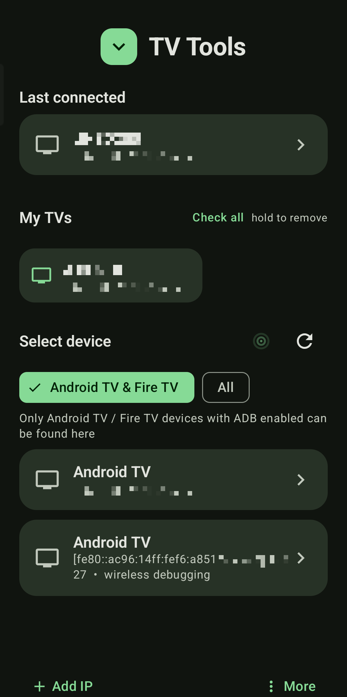 | 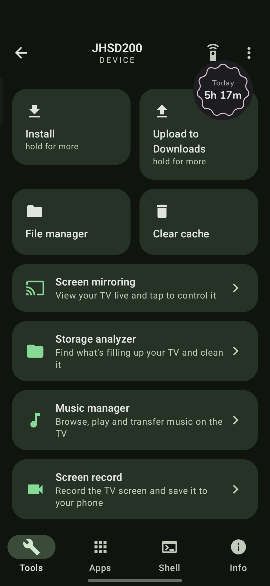 | 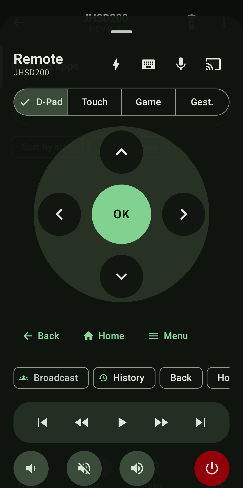 |
| 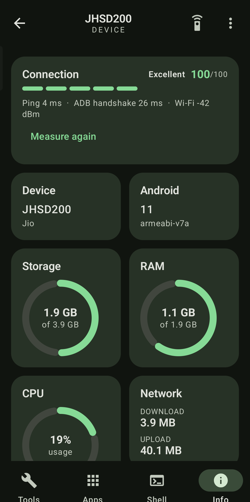 | 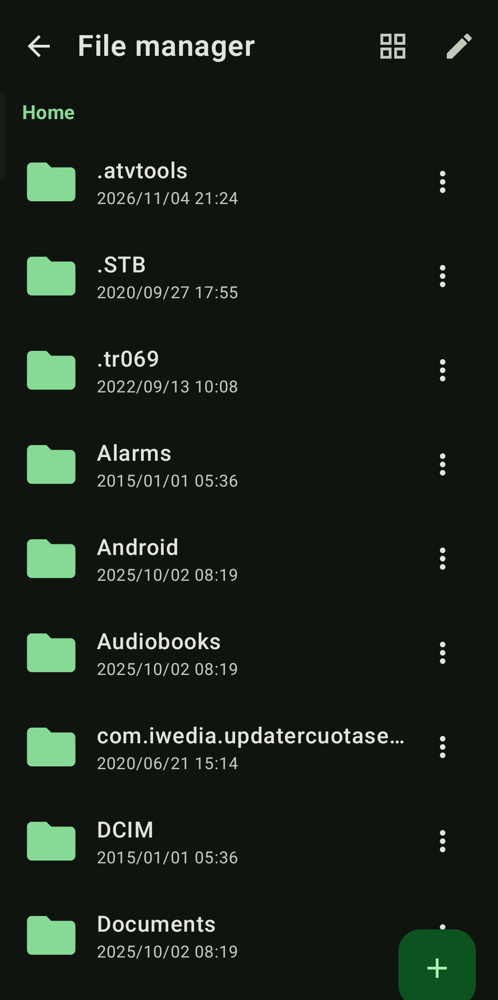 | 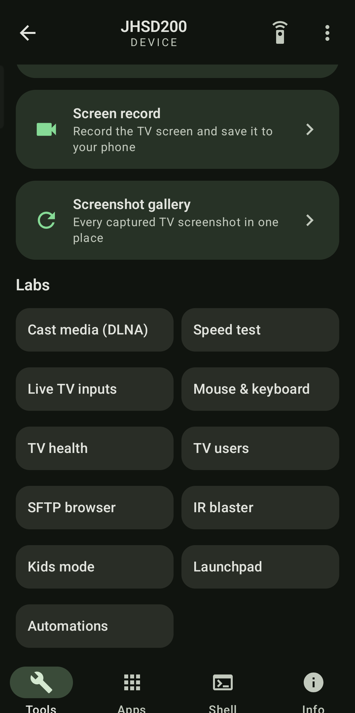 |
| 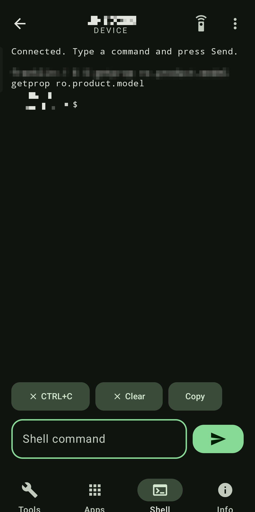 | 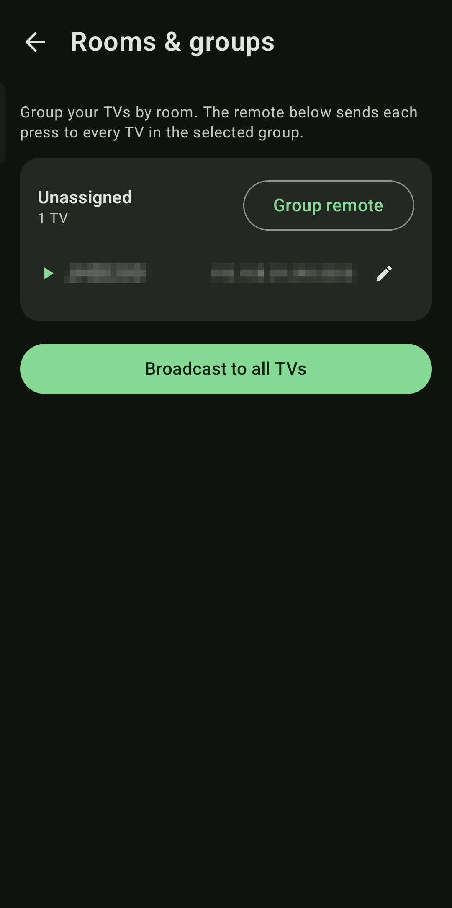 | 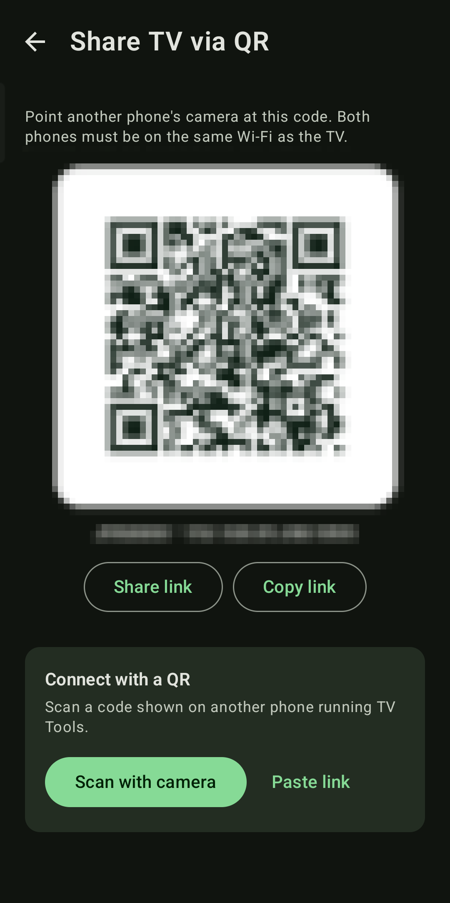 |
| 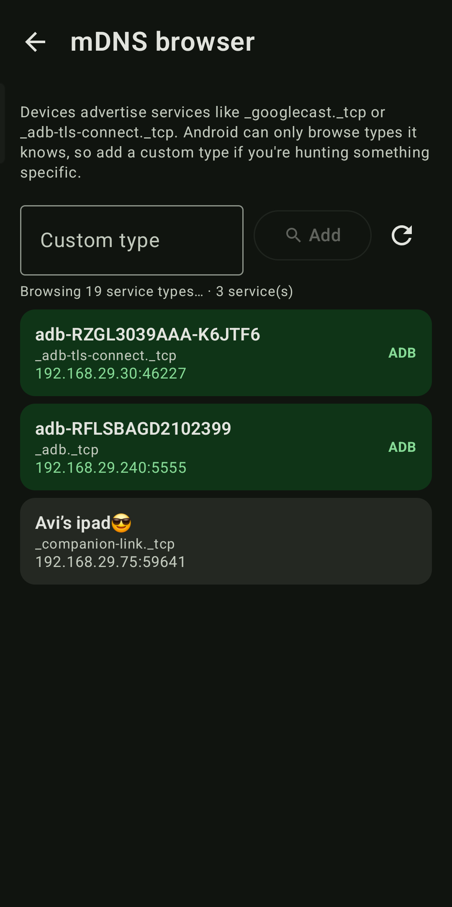 | 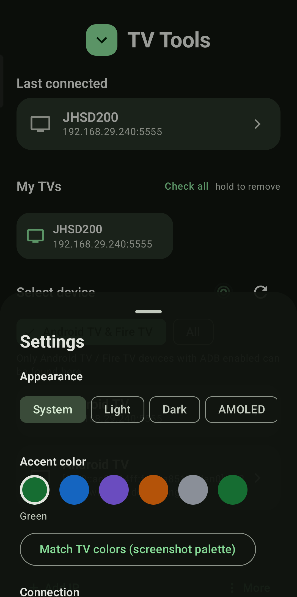 | 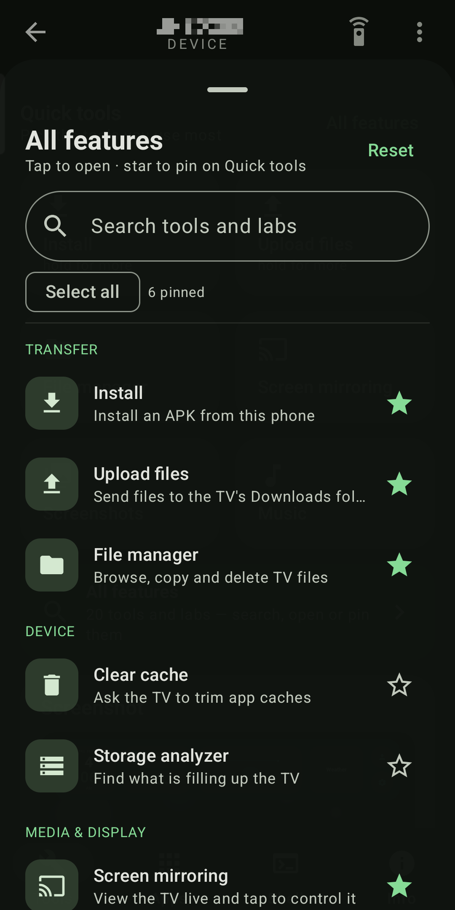 |
| 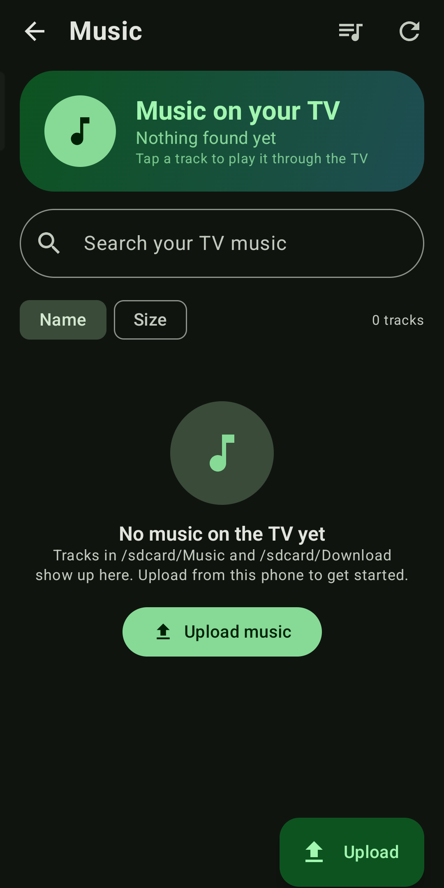 | | |

All screenshots are captured on a phone with the status bar and navigation bar cropped out. IP
addresses, device names/serials and the QR payload are pixelated for privacy.

## 🚀 Install

1. Download the latest **signed** APK from [Releases](../../releases).
2. Allow installs from unknown sources and install it.
3. Put your phone and TV on the **same Wi-Fi**.

## 📺 Enable ADB on your TV

**Android TV / Google TV / Xiaomi**
1. Settings → Device Preferences → About → tap **Build** 7 times.
2. Developer options → **Wireless debugging** → ON (Android 11+).
3. In TV Tools tap the TV → on the TV choose **Pair device with pairing code** → enter the 6-digit code.

**Amazon Fire TV**
1. Settings → My Fire TV → About → tap the device name 7 times.
2. Developer Options → **ADB debugging** → ON.
3. Connect from TV Tools (port 5555). Accept the "Allow debugging" prompt on the TV once.

## 🛠 Build from source

```bash
# Requirements: JDK 17, Android SDK 35
./gradlew assembleDebug      # debug APK
./gradlew assembleRelease    # signed release (add keystore.properties)

# APK → app/build/outputs/apk/debug/app-debug.apk
#       app/build/outputs/apk/release/app-release.apk
```

Release signing uses `keystore.properties` (git-ignored):
```properties
storeFile=tvtools-release.jks
storePassword=…
keyAlias=tvtools
keyPassword=…
```

## 🗺 Roadmap

- [x] Wireless ADB connect + pairing
- [x] Apps / files / shell / device info
- [x] Screen mirroring with touch control
- [x] Share-to-TV + Wake-on-LAN
- [x] Themes, haptics, modern remote
- [x] Bulk app backup & restore (split APKs)
- [x] Storage analyzer & cleanup
- [x] Multi-TV dashboard
- [x] Quick Settings tile & home-screen widget
- [x] Onboarding, splash screen, themed icon
- [x] DLNA casting, SFTP, speed test, live TV, mouse & keyboard
- [x] Health monitor, kids mode, users, launchpad, automations
- [x] App data backup + encrypted backup export/import
- [x] QR handoff, connection doctor, mDNS browser, IPv6 & custom ports
- [x] Rooms & groups, broadcast keys, wake schedule, guest mode
- [x] Live keyboard, voice typing, macros, per-app remotes, now playing
- [x] Gesture pad, air mouse, multi-touch pad, gamepad, sleep timer, ring TV
- [x] Quick keys, key history + undo, floating remote bubble
- [ ] Desktop/tablet layouts
- [ ] Cast media with Google Cast (requires Cast SDK receiver)

## 🤝 Contributing

Issues and pull requests are welcome. Start with [CONTRIBUTING.md](CONTRIBUTING.md); the project
keeps a [changelog](CHANGELOG.md) and a [security policy](SECURITY.md).

Please keep the app privacy-first: no telemetry, no cloud services.

## 📄 License

[MIT](LICENSE) © TV Tools contributors

<div align="center"><sub>Built with Kotlin & Jetpack Compose. Not affiliated with Google or Amazon.</sub></div>
